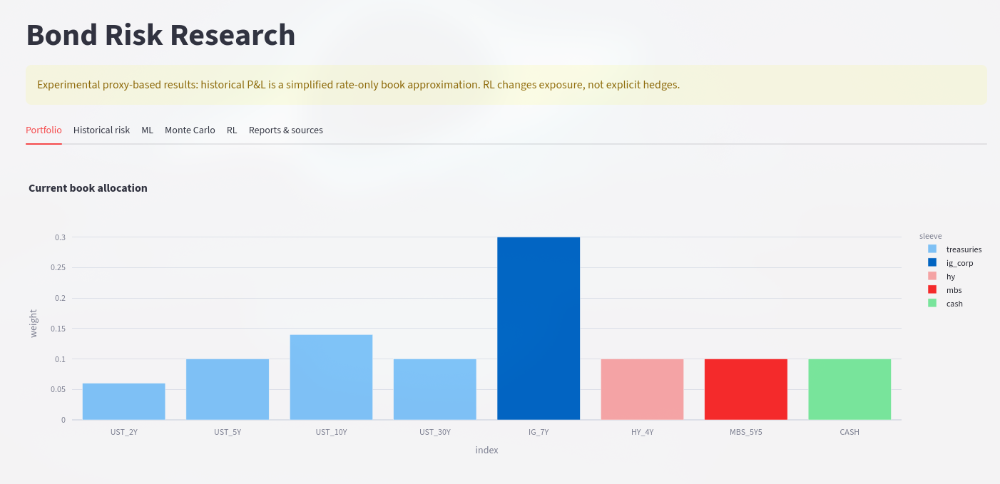
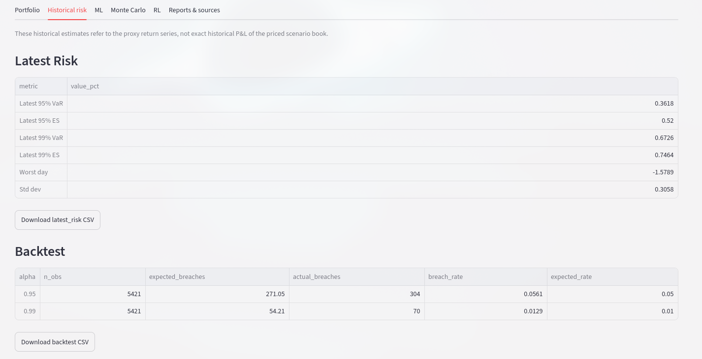
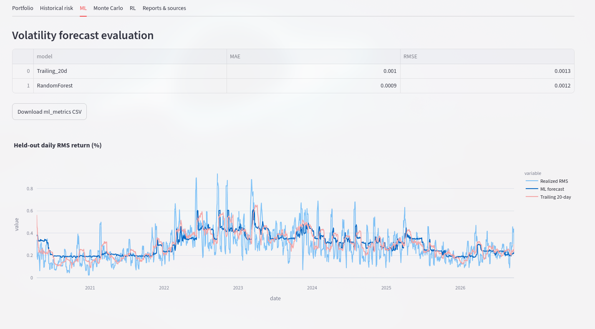
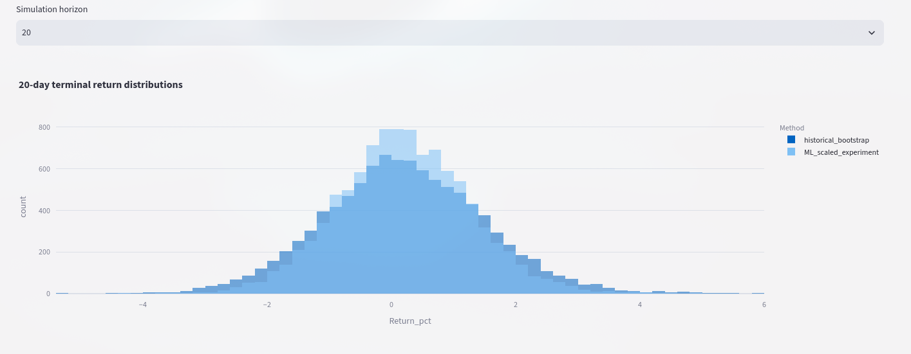
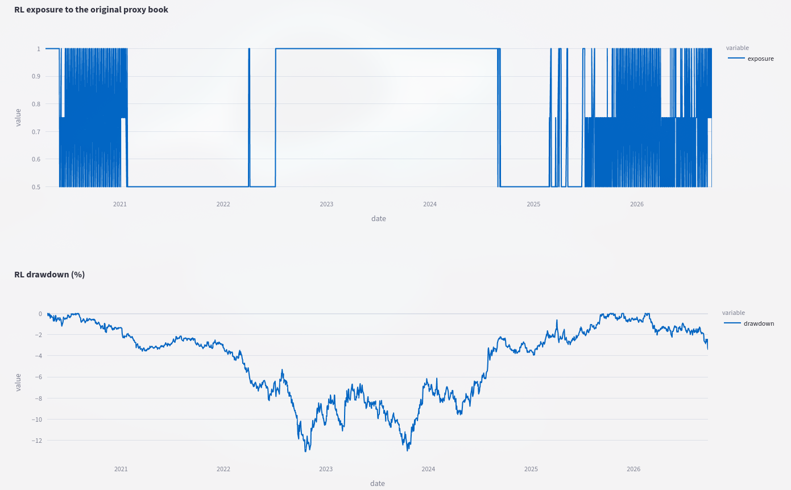
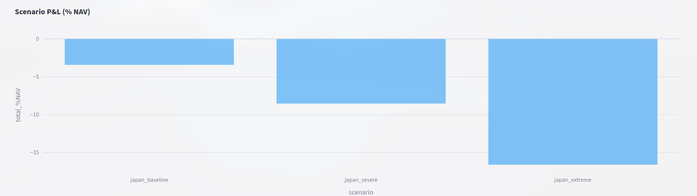

# Bond Risk Research

Quantitative risk analysis for a fixed-income portfolio under a hypothetical Japan MOF Treasury sell-off scenario.

## Overview

This project simulates end-to-end quantitative risk workflows for a bond portfolio, combining:

- **Historical risk metrics** — VaR, Expected Shortfall, duration, convexity
- **Machine learning** — volatility forecasting with feature importance
- **Monte Carlo simulation** — bootstrap and ML-scaled path simulation
- **Reinforcement learning** — exposure policy optimization
- **Scenario analysis** — stress testing and P&L attribution
- **Interactive dashboard** — Streamlit app with 6 tabs

## Dashboard

```
streamlit run dashboard/app.py
```

Then open **http://localhost:8501** in your browser.

### Screenshots

#### Portfolio Tab


#### Historical Risk Tab


#### ML Volatility Forecasting


#### Monte Carlo Simulation


#### RL Exposure Policies


#### Reports & Sources


## Quick Start

```bash
# Full pipeline (refresh data + retrain + generate reports + launch dashboard)
python scripts/run_project.py --refresh --dashboard

# Generate reports only (no retraining)
python scripts/run_project.py

# Launch dashboard directly (if results already exist)
streamlit run dashboard/app.py
```

## Project Structure

```
risk_analysis_project/
├── config/
│   ├── setting.yaml              # Portfolio and model parameters
│   └── data_sources.yaml         # Data source configuration
├── src/
│   ├── data/
│   │   ├── processors.py         # Data cleaning and alignment
│   │   └── ...
│   ├── models/
│   │   ├── bond_math.py          # Bond pricing, duration, convexity
│   │   ├── portfolio.py          # Portfolio construction
│   │   ├── portfolio_sim.py      # Portfolio simulation engine
│   │   ├── history_bridge.py     # Historical data bridge
│   │   └── ...
│   ├── risk/
│   │   └── var_bridge.py         # VaR/ES computation
│   ├── reporting/
│   │   ├── report_tables.py      # Report table generation
│   │   └── charts.py             # Chart generation
│   └── ...
├── scripts/
│   ├── build_history.py          # Build historical dataset
│   ├── train_volatility_ml.py    # ML volatility model training
│   ├── run_learning_mc.py        # Monte Carlo simulation
│   ├── train_mc_risk_agent.py    # RL policy training
│   ├── export_tables.py          # Export results to CSV
│   ├── finalize_report.py        # Generate final PDF/Excel reports
│   ├── build_charts.py           # Generate static charts
│   ├── run_var_bridge.py         # Run VaR computation
│   └── run_project.py            # Master orchestrator
├── dashboard/
│   └── app.py                    # Streamlit dashboard
├── tests/                        # Unit tests
├── output/                       # Generated reports, charts, tables
├── screenshots/                  # Dashboard screenshots
└── README.md
```

## Deliverables

### Risk Report (PDF)
[](output/reports/risk_report.pdf)

Full risk analysis report covering portfolio allocation, historical risk metrics, ML volatility forecasts, Monte Carlo simulation results, and RL policy evaluation.

### Results (Excel)
[](output/reports/risk_results.xlsx)

Excel workbook with all results: portfolio holdings, scenario P&L, risk metrics, ML forecasts, Monte Carlo paths, and RL policy metrics.

### All Deliverables (ZIP)
[](output/reports/risk_deliverables.zip)

All deliverables packaged together: PDF report, Excel workbook, static charts, and metadata.

### Static Charts

Charts are also available in `output/charts/`:
- `scenario_pnl.png` — Scenario P&L bar chart
- `mc_distribution.png` — Monte Carlo return distribution
- `ml_forecast.png` — ML volatility forecast
- `policy_equity.png` — RL policy equity curves

## Requirements

```bash
pip install -r requirements.txt
```

Or use the conda environment file:

```bash
conda env create -f environment.yml
conda activate risk_analysis
```

## Key Dependencies

- `streamlit`, `plotly` — Dashboard and visualization
- `pandas`, `numpy`, `scipy` — Data manipulation and computation
- `scikit-learn` — Machine learning
- `matplotlib` — Static chart generation

## Testing

```bash
pytest tests/ -v
```

## Disclaimer

This is an experimental proxy-based analysis. Historical P&L is a simplified rate-only book approximation. ML scaling is experimental and is not an out-of-sample VaR coverage test. Reducing exposure can reduce losses without improving the investment policy.